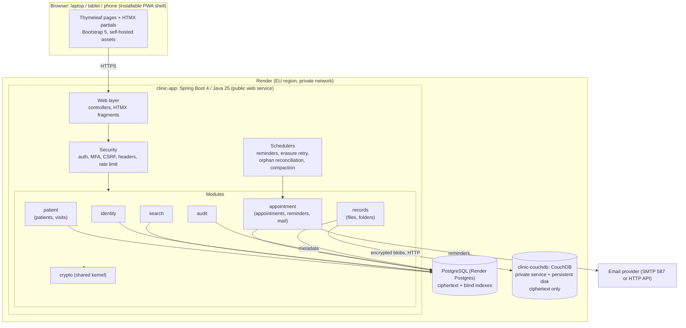
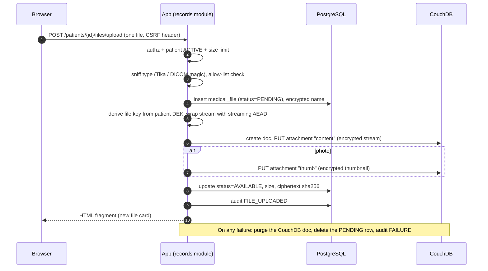
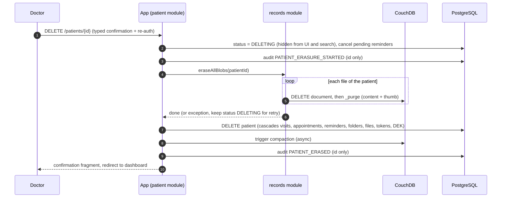

# PatientVault — Technical Design & Requirements Specification

> **Audience:** an autonomous coding agent that will implement this application end to end.
> **How to use this document:** treat sections marked **MUST** as binding. Sections marked **SHOULD** are strong defaults. Anything marked **OPTIONAL** is only done after all MUST items pass their acceptance criteria. If something in this document is ambiguous or impossible, make the smallest reasonable decision, record it in `docs/DECISIONS.md`, and continue. Do not stop to ask questions.

---

## 0. Executive summary

PatientVault is a web application for **a single doctor** to store, organise and quickly find patient records, including medical files (photos, PDFs, DICOM files and whole folders). It is a **modular monolith** built with **Java 25 + Spring Boot 4**, a server-rendered UI (**Thymeleaf + HTMX**), **PostgreSQL** for relational data and **CouchDB** for file/object storage. Every sensitive value is encrypted at the application level before it reaches either database. The application ships as Docker images and is deployed to **Render** (EU region).

Guiding principles:

1. **Security and privacy first.** The data is special-category health data under GDPR (Art. 9). Defence in depth: the databases must never hold readable personal or medical data.
2. **Simple to operate.** One deployable application, two datastores. No message brokers, no search cluster, no SPA build chain.
3. **Fast for the doctor.** One search box, results in well under a second, usable on a phone in the consulting room.
4. **Auditable.** Every action is logged; no log line ever contains patient personal data.
5. **Evolvable.** Single `DOCTOR` role today; the model, security config and module boundaries must make adding limited roles later a small change.

---

## 1. Functional requirements

IDs are used in tests and commits (e.g. `FR-4`). Acceptance criteria (AC) are in section 12.

| ID | Requirement |
|---|---|
| **FR-1** | The doctor can **create a patient**. Stored attributes: first name, last name, email, mobile phone, AMKA, first visit date, description, diagnosis details, "how you found the doctor" (referral source), consent flag, free-text notes. The patient can also have object data: photos, PDFs, DICOM files and **folders** of such files. **Mandatory:** name (first + last), email, mobile phone, AMKA. |
| **FR-2** | The doctor can **search** existing patients by **name, email, mobile phone or AMKA** from a single search box. |
| **FR-3** | Search results show the patient's **stored personal data** and a **link to the patient's medical data** (photos, PDFs, DICOM, folders). |
| **FR-4** | The doctor can **delete a patient and all personal and medical data** (relational rows and every file in object storage) when needed. |
| **FR-5** | The doctor can **edit** personal and medical data, **add new visits/diagnoses**, and **add, rename, move or delete files and folders**. |
| **FR-6** | The doctor receives **email reminders at a personal email address** for scheduled patient appointments. |

### 1.1 Clarified functional behaviour (decisions already taken)

- **Name** means `first_name` and `last_name`; both are mandatory.
- **Visits:** a patient has 1..n *visits*. Each visit has a date, description and diagnosis details. Creating a patient with a first visit date/description/diagnosis creates the first visit. FR-5 "add new medical data" includes adding further visits.
- **Appointments (FR-6)** are future-dated scheduled visits. They are a separate concept from past *visits* (a completed appointment can be converted into a visit with one click).
- **Validation rules** (server-side authoritative, client-side hints only):
  - Email: valid syntax, normalised to lower case.
  - Mobile: parsed with libphonenumber, default region `GR`, stored as E.164 (e.g. `+306912345678`). Inputs `6912345678`, `+30 691 234 5678` and `00306912345678` are equivalent.
  - **AMKA:** exactly 11 digits (spaces and dashes stripped), **Luhn checksum valid**. The first six digits encode the date of birth as DDMMYY; a non-parsable date is a **warning**, not an error. Make strictness configurable (`app.validation.amka.strict-date=false`).
  - AMKA is **unique** per patient (enforced via blind index, see 6.3). Email and mobile may repeat (e.g. family members); show a non-blocking warning when a duplicate is detected.
- **Consent flag:** boolean `consent_given` plus `consent_recorded_at` set automatically when the flag changes to `true`. It is informational (it does not block saving) but is shown as a badge on the patient card and the patient page.
- **Deletion is a hard, irreversible erase** (no soft delete) with strong confirmation (see 8.4).
- The UI language defaults to **English** with a complete **Greek (`el`)** translation through Spring `MessageSource` bundles and a language switch. No user-facing string may be hard-coded in a template.

---

## 2. Non-functional requirements

| ID | Requirement |
|---|---|
| **NFR-1** | UI built with **Thymeleaf and HTMX**: modern, sleek, clean, **responsive** (laptop, tablet, phone). Server-rendered; HTMX for partial updates; **no SPA framework**. |
| **NFR-2** | **Java 25** and **Spring Boot 4.x** (latest stable 4.x patch). Core is a **modular monolith**. Persistence via **Spring Data JPA + Hibernate** (Hibernate 7 ships with Boot 4). |
| **NFR-3** | **Spring Security** for authentication/authorisation of the master user (the doctor). |
| **NFR-4** | **PostgreSQL** is the relational database. **CouchDB** is the object/file store. |
| **NFR-5** | **Robust, layered security.** All personal and medical data is protected and **encrypted** in transit, at rest and at application level (section 6 and 7). |
| **NFR-6** | **Containerised** (Docker), deployable to a cloud provider; **Render** is the reference target (section 11). |
| **NFR-7** | Single master role (`ROLE_DOCTOR`) now; authorisation structured so additional, more limited roles can be added later without refactoring (section 7.6). |
| **NFR-8** | **Robust logging:** all actions are logged (technical, access, security and audit logs) without leaking personal data (section 9). |

### 2.1 Quality targets

| Area | Target |
|---|---|
| Search latency | p95 < 500 ms for 20,000 patients on the reference Render plan |
| Page load (server time) | p95 < 300 ms for list/detail pages, excluding file streaming |
| File size | Default max **100 MB per file** (configurable `app.uploads.max-file-size`) |
| Responsive | Fully usable at 360 px width; touch targets ≥ 44 px |
| Accessibility | Lighthouse accessibility ≥ 90; semantic HTML; keyboard operable; visible focus |
| Test coverage | ≥ 80 % line coverage on services; every acceptance criterion has an automated test |
| Startup | Application starts and reports healthy within 90 s on the target plan |

---

## 3. Technology stack (binding)

| Concern | Choice | Notes |
|---|---|---|
| Language | **Java 25** (LTS) | Use records, sealed types, pattern matching, virtual threads where sensible. |
| Framework | **Spring Boot 4.x** (Spring Framework 7, Spring Security 7, Spring Data 2025.x, Hibernate 7, Jakarta EE 11) | Boot 4 has first-class Java 25 support. Pin the exact versions via the Boot BOM; do not mix 3.x libraries. Jackson 3 (`tools.jackson`) is the default JSON library in Boot 4. |
| Build | **Maven** (wrapper committed), single module with package-level module boundaries | A Maven multi-module layout is **not** required. |
| UI | **Thymeleaf** + **HTMX 2.x** + **Bootstrap 5.3** (self-hosted, vendored via WebJars or `static/`) + Bootstrap Icons | No CDN: all JS/CSS served from the app origin so the CSP can be strict and no third party sees page loads. No Node.js step in the build. |
| HTMX integration | `htmx-spring-boot` + `htmx-spring-boot-thymeleaf` (**5.x line pairs with htmx 2.x; 6.x pairs with htmx 4.x**) | Check the library compatibility table against Boot 4 before pinning. If incompatible, drop the library and use a small internal helper for `HX-*` headers. Record the choice in `docs/DECISIONS.md`. |
| Relational DB | **PostgreSQL 17 or 18** (match the Render-managed version) | Flyway migrations; `spring.jpa.hibernate.ddl-auto=validate`. |
| Object store | **Apache CouchDB 3.x** (official `couchdb` image) | Accessed over its HTTP API through a `BlobStore` port (see 5.3). |
| Crypto | **Google Tink** (AEAD for fields, streaming AEAD for files, HKDF, HMAC) | **Never hand-roll crypto.** |
| Security | Spring Security 7; Argon2id (BouncyCastle) password hashing; TOTP MFA (e.g. `com.eatthepath:java-otp`) ; ZXing for QR enrolment | |
| Phone numbers | `libphonenumber` | |
| Text normalisation | `java.text.Normalizer` (NFD) + Greek final-sigma handling | See 6.3. |
| Upload inspection | Apache Tika (MIME sniffing); custom DICOM magic check | |
| Images | Thumbnailator for JPEG/PNG/WebP thumbnails | |
| Email | Spring `JavaMailSender` (SMTP) behind a `MailSender` port; Thymeleaf text/HTML email templates | |
| Scheduling | Spring `@Scheduled` + DB-backed reminder table (`FOR UPDATE SKIP LOCKED`) | No Quartz needed. |
| Rate limiting | Bucket4j (in-memory) | |
| Logging | Logback with **Spring Boot structured JSON logging** | |
| Observability | Spring Boot Actuator (health only is public); Micrometer | |
| Module boundaries | **Spring Modulith** (`ApplicationModules.verify()` in a test) or **ArchUnit** if Modulith is incompatible with the chosen Boot version | |
| Tests | JUnit 5, AssertJ, Mockito, **Testcontainers** (PostgreSQL + CouchDB), GreenMail (SMTP), Spring Security Test, MockMvc/`RestTestClient`, Playwright for a small E2E smoke suite | |
| Containers | Multi-stage Dockerfiles; Docker Compose for local development | |

---

## 4. Logical architecture



### 4.1 Module responsibilities and allowed dependencies

| Module | Owns | May depend on |
|---|---|---|
| `crypto` (shared kernel) | Key ring, envelope encryption, field and stream encryption, blind-index HMAC | – |
| `audit` (shared kernel) | `AuditService`, audit log table, audit page | `crypto` (none for payload) |
| `identity` | Doctor account, login, MFA, lockout, password change, sessions | `audit` |
| `patient` | Patient aggregate, visits, patient forms, **erasure orchestration** | `crypto`, `search`, `audit`, `records` (API only) |
| `search` | Normalisation, blind-index tokens, query parsing, search service and results page | `crypto` |
| `records` | Files, folders, upload/download, thumbnails, `BlobStore` + CouchDB adapter | `crypto`, `audit` |
| `appointment` | Appointments, reminders, scheduler, email composition and sending | `patient` (API only), `audit` |

Rules:
- Each module exposes a small public API in its root package (`api` types or a facade service). Everything else lives in sub-packages (`internal`, `web`, `persistence`) and is **package-private or module-internal**.
- No module accesses another module's JPA entities or repositories. Use the facade interfaces or domain events (Spring `ApplicationEventPublisher`).
- Cross-module database foreign keys are allowed (single database) but cascade logic must still be orchestrated in code where files in CouchDB are involved.
- The module boundary test must fail the build on violations.

### 4.2 Package layout

```
com.example.patientvault            (rename the base package freely, keep it consistent)
├── PatientVaultApplication.java
├── shared/            error handling, time (Clock bean), web helpers, i18n, config properties
├── crypto/            CryptoService, KeyRing, FieldCipher, StreamCipher, BlindIndexer, KeyRotationJob
├── audit/             AuditService, AuditEvent, AuditAction, AuditLogEntity, AuditController
├── identity/          DoctorUser, UserDetailsService, MfaService, LoginController, SecurityConfig
├── patient/
│   ├── PatientApi.java            (public facade)
│   ├── internal/ (entities, repositories, services, PatientCodec, PatientErasureService)
│   └── web/      (PatientController, forms, fragments)
├── search/
├── records/
│   ├── RecordsApi.java
│   ├── blob/     BlobStore (port), CouchDbBlobStore (adapter), CouchDbClient, CouchDbInitializer
│   └── internal/, web/
├── appointment/
│   ├── internal/ (Appointment, Reminder, ReminderScheduler, MailSender port + SMTP adapter)
│   └── web/
└── resources/
    ├── templates/ (layout, fragments, pages, email)
    ├── static/ (css, js, icons, manifest.webmanifest, service worker)
    ├── db/migration/ (Flyway V1__*.sql ...)
    ├── messages.properties, messages_el.properties
    └── application.yml, application-local.yml, application-test.yml, logback-spring.xml (only if needed)
```

---
## 5. Data design
 
### 5.1 Storage split
 
| Data | Where | Form |
|---|---|---|
| Doctor account, patients, visits, appointments, reminders, folder tree, file **metadata**, search tokens, audit log | PostgreSQL | Sensitive columns are **ciphertext** (`bytea`) |
| File **content** (photos, PDFs, DICOM, other) and thumbnails | CouchDB | **Ciphertext only** (stored as an attachment) |
 
PostgreSQL must never contain a readable name, email, phone, AMKA, diagnosis, description, note, file name or free text about a patient. CouchDB must never contain readable file content or file names.
 
### 5.2 PostgreSQL schema (Flyway `V1__init.sql` and onward)
 
Use UUIDs (v7 if available, else v4) as primary keys, `timestamptz` for all instants, `created_at/updated_at` on every table, and optimistic locking (`version bigint`) on mutable aggregates. Columns suffixed `_enc` are `bytea` ciphertext produced by the crypto module.
 
```sql
-- identity
CREATE TABLE app_user (
id uuid PRIMARY KEY,
username text NOT NULL UNIQUE,
password_hash text NOT NULL,
notification_email_enc bytea, -- where reminders are sent (doctor's personal email)
totp_secret_enc bytea,
totp_enabled boolean NOT NULL DEFAULT false,
must_change_password boolean NOT NULL DEFAULT true,
failed_attempts int NOT NULL DEFAULT 0,
locked_until timestamptz,
last_login_at timestamptz,
created_at timestamptz NOT NULL, updated_at timestamptz NOT NULL, version bigint NOT NULL DEFAULT 0
);
CREATE TABLE recovery_code ( -- 10 single-use MFA recovery codes, stored hashed
id uuid PRIMARY KEY, user_id uuid NOT NULL REFERENCES app_user(id) ON DELETE CASCADE,
code_hash text NOT NULL, used_at timestamptz
);
 
-- patients
CREATE TABLE patient (
id uuid PRIMARY KEY,
status text NOT NULL DEFAULT 'ACTIVE', -- ACTIVE | DELETING (hidden from UI/search, erasure in progress)
dek_wrapped bytea NOT NULL, -- per-patient data-encryption key, wrapped by the key-encryption key
key_id text NOT NULL, -- key ring version used to wrap the DEK
first_name_enc bytea NOT NULL,
last_name_enc bytea NOT NULL,
email_enc bytea NOT NULL,
mobile_enc bytea NOT NULL,
amka_enc bytea NOT NULL,
referral_source_enc bytea, -- "how you found the doctor"
notes_enc bytea,
consent_given boolean NOT NULL DEFAULT false,
consent_recorded_at timestamptz,
created_at timestamptz NOT NULL, updated_at timestamptz NOT NULL, version bigint NOT NULL DEFAULT 0
);
 
CREATE TABLE patient_search_token ( -- blind indexes (see 6.3)
patient_id uuid NOT NULL REFERENCES patient(id) ON DELETE CASCADE,
kind text NOT NULL, -- NAME_PREFIX | EMAIL | MOBILE | AMKA
token bytea NOT NULL, -- HMAC-SHA256 output
PRIMARY KEY (patient_id, kind, token)
);
CREATE INDEX ix_pst_kind_token ON patient_search_token (kind, token);
CREATE UNIQUE INDEX ux_pst_amka ON patient_search_token (token) WHERE kind = 'AMKA';
 
CREATE TABLE visit (
id uuid PRIMARY KEY,
patient_id uuid NOT NULL REFERENCES patient(id) ON DELETE CASCADE,
visit_date date NOT NULL,
description_enc bytea,
diagnosis_enc bytea,
treatment_enc bytea,
created_at timestamptz NOT NULL, updated_at timestamptz NOT NULL, version bigint NOT NULL DEFAULT 0
);
CREATE INDEX ix_visit_patient_date ON visit (patient_id, visit_date DESC);
 
-- appointments and reminders
CREATE TABLE appointment (
id uuid PRIMARY KEY,
patient_id uuid NOT NULL REFERENCES patient(id) ON DELETE CASCADE,
scheduled_at timestamptz NOT NULL,
duration_minutes int NOT NULL DEFAULT 30,
status text NOT NULL DEFAULT 'SCHEDULED', -- SCHEDULED | COMPLETED | CANCELLED
reason_enc bytea,
created_at timestamptz NOT NULL, updated_at timestamptz NOT NULL, version bigint NOT NULL DEFAULT 0
);
CREATE INDEX ix_appt_time ON appointment (scheduled_at) WHERE status = 'SCHEDULED';
 
CREATE TABLE reminder (
id uuid PRIMARY KEY,
appointment_id uuid NOT NULL REFERENCES appointment(id) ON DELETE CASCADE,
remind_at timestamptz NOT NULL,
status text NOT NULL DEFAULT 'PENDING', -- PENDING | SENT | FAILED | EXPIRED | CANCELLED
attempts int NOT NULL DEFAULT 0,
next_attempt_at timestamptz,
last_error text, -- technical error only, no personal data
sent_at timestamptz
);
CREATE INDEX ix_reminder_due ON reminder (remind_at) WHERE status = 'PENDING';
 
-- records (metadata only; content lives in CouchDB)
CREATE TABLE medical_folder (
id uuid PRIMARY KEY,
patient_id uuid NOT NULL REFERENCES patient(id) ON DELETE CASCADE,
parent_id uuid REFERENCES medical_folder(id) ON DELETE CASCADE, -- NULL = root
name_enc bytea NOT NULL,
created_at timestamptz NOT NULL, updated_at timestamptz NOT NULL
);
CREATE TABLE medical_file (
id uuid PRIMARY KEY,
patient_id uuid NOT NULL REFERENCES patient(id) ON DELETE CASCADE,
folder_id uuid REFERENCES medical_folder(id) ON DELETE CASCADE,
visit_id uuid REFERENCES visit(id) ON DELETE SET NULL,
category text NOT NULL, -- PHOTO | PDF | DICOM | OTHER
display_name_enc bytea NOT NULL, -- original file name (may contain personal data)
mime_type text NOT NULL, -- detected server-side
size_bytes bigint NOT NULL, -- plaintext size
ciphertext_sha256 bytea, -- integrity check of the stored blob
couch_doc_id text NOT NULL UNIQUE,
has_thumbnail boolean NOT NULL DEFAULT false,
status text NOT NULL DEFAULT 'PENDING', -- PENDING | AVAILABLE | DELETING
uploaded_at timestamptz NOT NULL, updated_at timestamptz NOT NULL
);
CREATE INDEX ix_file_patient ON medical_file (patient_id, folder_id);
 
-- audit (append-only)
CREATE TABLE audit_log (
id bigserial PRIMARY KEY,
occurred_at timestamptz NOT NULL DEFAULT now(),
request_id text,
actor text NOT NULL, -- username or 'SYSTEM' or 'ANONYMOUS'
actor_ip text,
action text NOT NULL, -- see 9.3
entity_type text,
entity_id text, -- UUIDs only, never names
outcome text NOT NULL, -- SUCCESS | FAILURE | DENIED
details jsonb -- non-personal context only (e.g. changed field NAMES, counts)
);
CREATE INDEX ix_audit_time ON audit_log (occurred_at DESC);
CREATE INDEX ix_audit_entity ON audit_log (entity_type, entity_id);
-- trigger that RAISES on UPDATE or DELETE of audit_log (append-only)
```
 
JPA mapping rules:
- Entities map `_enc` columns as `byte[]`. **Entities never hold plaintext.** Plaintext exists only in immutable domain records (e.g. `PatientData`) created by `PatientCodec` in the service layer, and in view models.
- Override `toString()` on every entity/record that could hold personal data to print IDs only. Never use Lombok `@Data`/`@ToString` on those types.
- Enable Hibernate batch fetching; avoid N+1 on search result pages (fetch the page's patients in one query, then decrypt in memory).
 
### 5.3 CouchDB design
 
- One database: **`patient_files`**, created at startup by `CouchDbInitializer` if missing (idempotent), together with the system databases required by a single-node setup (`_users`, `_replicator`, `_global_changes` optional).
- **One CouchDB document per file.** `_id` = the `medical_file.couch_doc_id` (UUID string). Document JSON contains **no personal data**:
 
```json
{
"_id": "6f1c...-uuid",
"type": "medical-file",
"patientId": "uuid",
"keyId": "v1",
"cipher": "AES256_GCM_HKDF_1MB",
"plaintextSize": 1234567,
"createdAt": "2026-10-23T09:00:00Z"
}
```
- Attachments on that document: `content` (encrypted file, content type `application/octet-stream`) and optionally `thumb` (encrypted thumbnail). The real MIME type is kept only in PostgreSQL.
- Mango index on `patientId` (`POST /patient_files/_index`) used **only** by the reconciliation job (8.5); normal reads use IDs from PostgreSQL.
- Why attachments are not "chunked": CouchDB works best with small-to-medium attachments (large attachments slow replication and add compaction churn and cannot be resumed after a broken upload). Therefore: default max file size 100 MB, one file per document, and a dedicated database that is separate from any other data. DICOM studies are stored as **many small files** (one per `.dcm`), grouped by the folder tree in PostgreSQL, which is the natural size profile for CouchDB.
- CouchDB configuration (in the CouchDB image, `local.d/10-patientvault.ini`, plus env vars for credentials):
- `[couchdb] single_node = true`
- `[chttpd] require_valid_user = true`, bind address `0.0.0.0` (the service is reachable only on the private network)
- `[chttpd] max_http_request_size` and `[couchdb] max_attachment_size` set explicitly to a value ≥ the app's max file size plus overhead
- `[couchdb] default_security = admin_only`
- Credentials from environment (`COUCHDB_USER`, `COUCHDB_PASSWORD`). The application authenticates with a **dedicated non-admin database user** (`patientvault_app`) created by `CouchDbInitializer`, granted as `member` on `patient_files` only.
- `BlobStore` port (the rest of the code never talks to CouchDB directly):
 
```java
public interface BlobStore {
BlobRef put(UUID fileId, UUID patientId, InputStream encryptedContent, long ciphertextLength, BlobMeta meta);
void putThumbnail(BlobRef ref, InputStream encryptedThumb);
InputStream openContent(BlobRef ref); // streaming, caller closes
Optional<InputStream> openThumbnail(BlobRef ref);
void erase(BlobRef ref); // DELETE + _purge, idempotent
void compact(); // POST /patient_files/_compact
Set<String> listAllDocumentIds(); // for reconciliation
}
```
- `CouchDbClient` uses Spring `RestClient` (or `java.net.http.HttpClient`) with **streaming** request/response bodies (no whole-file buffering in heap), connect/read timeouts, bounded retries with backoff for idempotent calls, and a circuit-breaker-style failure counter surfaced in `/actuator/health`.
- Upload sequence inside `CouchDbBlobStore.put`: create the document (`PUT /patient_files/{id}`), then `PUT /patient_files/{id}/content?rev=...`. If the second call fails, delete the document (compensation) and rethrow.
 
---

## 6. Encryption and key management (MUST)

### 6.1 Principles

- **Application-level encryption** happens before data leaves the JVM. PostgreSQL and CouchDB are *untrusted storage*: a leaked database dump, disk snapshot or backup must reveal nothing readable.
- Disk/volume encryption provided by the host platform and TLS on every hop are **additional** layers, not a substitute.
- **Per-patient data-encryption key (DEK)** gives **crypto-shredding**: deleting a patient destroys the DEK, making any leftover ciphertext (replicas, tombstones, backups) permanently unreadable.

### 6.2 Key hierarchy

```
APP_MASTER_KEYS (env secret, 256-bit keys, versioned: "v1:<base64>,v2:<base64>")
   │  HKDF-SHA256 with distinct "info" labels
   ├── KEK            wraps/unwraps each patient's DEK            (AES-256-GCM)
   ├── BLIND_INDEX_KEY HMAC-SHA256 key for search tokens
   └── USER_SECRET_KEY encrypts doctor-level secrets (TOTP secret, notification email)

Per patient: DEK (random 256-bit) ── encrypts every patient field, visit/appointment text,
                                       file names, file content, thumbnails of that patient
```

- `APP_MASTER_KEYS` + `APP_ACTIVE_KEY_ID` come from environment variables (Render secret). The application **refuses to start** if the key ring is missing, malformed, or keys are shorter than 256 bits. Keys are never logged and never written to disk.
- **Key rotation (SHOULD):** adding `v2` and switching `APP_ACTIVE_KEY_ID` must work without downtime. `KeyRotationJob` (admin-triggered) re-wraps all DEKs with the new KEK. Ciphertext carries its `keyId`, so old keys stay available for decryption until rotation completes. Rotating the blind-index key requires re-indexing (provide a `ReindexSearchTokensJob`).
- Document in `docs/OPERATIONS.md` that **losing the master key means permanent data loss**, and that a copy must be escrowed offline by the doctor/owner.
- Design the `KeyRing` behind an interface (`KeyProvider`) so a managed KMS (e.g. a cloud key vault) can replace the env-based provider later.

### 6.3 Field encryption and searchable (blind) indexes

- **Field encryption:** Tink `Aead` (AES-256-GCM) with the patient's DEK. **Associated data = `patientId || fieldName`** so ciphertext cannot be moved between rows or fields. Ciphertext layout: `version(1) | keyId | nonce | ciphertext+tag` (Tink handles the nonce).
- `PatientCodec` is the only class that converts between `PatientEntity` (ciphertext) and `PatientData` (plaintext). It unwraps the DEK (short-lived, size-bounded in-memory cache, ≤ 5 min TTL, never serialised).
- **Searching encrypted data** uses **blind indexes** stored in `patient_search_token`. A token is `HMAC-SHA256(BLIND_INDEX_KEY, kind || ":" || normalisedValue)`.

| Field | Tokens stored | Search semantics |
|---|---|---|
| AMKA | one token of the 11 digits (digits only) | exact match; also enforces uniqueness |
| Email | one token of the lower-cased address | exact match |
| Mobile | one token of the E.164 number | exact match, input format–insensitive |
| Name (first and last) | one token per **prefix** of each name token, lengths `min-prefix..max-prefix` (defaults 3..15) | "starts with" per word; multiple words are AND-ed (order-independent) |

- **Normalisation (`TextNormalizer`)**: Unicode NFD → strip combining marks (accents/tonos) → lower-case (`Locale.ROOT`) → map Greek final sigma `ς` to `σ` → collapse whitespace. This makes `Παγκάλος`, `ΠΑΓΚΑΛΟΣ` and `παγκαλοσ` equal. **OPTIONAL:** Greek-to-Latin transliteration (Greeklish) tokens so `Pagkalos` also finds `Παγκάλος`.
- Known and accepted limits (document them in the UI help text): partial email or partial phone search is not supported; name search needs at least `min-prefix` characters per word; blind indexes reveal equality and prefix patterns to someone with database access but not the values.
- Query classification in `SearchQueryParser`:
  1. 11 digits (ignoring spaces/dashes) → AMKA lookup;
  2. contains `@` → email lookup;
  3. mostly digits/`+`/spaces with ≥ 6 digits → mobile lookup (normalised through libphonenumber);
  4. otherwise → name-prefix lookup (AND across words).
  A short or ambiguous query returns a helpful message, not an error.

### 6.4 File encryption (streaming)

- Use Tink **streaming AEAD** (`AES256_GCM_HKDF_1MB`, segment size 1 MB) with a per-file key derived from the patient DEK and the file ID (HKDF). Encrypt as the upload streams through; decrypt as the download streams out. **Never load a whole file into memory.**
- File name, folder name, MIME type metadata: file/folder names are encrypted as fields (they may contain personal data); MIME and size are stored plainly in PostgreSQL (non-identifying, needed for rendering).
- The authentication tags make tampering with stored blobs detectable; a failed decrypt returns HTTP 500 to the user with a generic message and writes a `SECURITY` log event and `FILE_INTEGRITY_FAILURE` audit event.

### 6.5 Transport and platform encryption

- Browser ↔ app: **TLS only** (provided by the platform edge); HSTS enabled.
- App ↔ PostgreSQL: TLS required in the JDBC URL (`sslmode=require`, prefer `verify-full` where the provider supports it).
- App ↔ CouchDB: private network only; the payloads are already ciphertext and the JSON contains no personal data. Add optional TLS support via configuration (`app.couchdb.url=https://...`).
- App ↔ SMTP provider: STARTTLS/TLS mandatory (`mail.smtp.starttls.required=true`).

---

## 7. Security requirements (MUST unless marked)

### 7.1 Authentication (Spring Security)

- **Single master user** (`ROLE_DOCTOR`), form login at `/login`. No public registration. The account is **bootstrapped on first start** from `APP_BOOTSTRAP_USERNAME` / `APP_BOOTSTRAP_PASSWORD` (only if no user exists); `must_change_password=true` forces a password change at first login. Bootstrap credentials are never logged.
- Password hashing: **Argon2id** (`Argon2PasswordEncoder`, Spring Security recommended parameters) through `DelegatingPasswordEncoder`, so hashes can be upgraded. Password policy: ≥ 12 characters, checked against a small common-password list; no composition gimmicks.
- **TOTP MFA** (RFC 6238) enrolment with QR code, mandatory by default (`app.security.mfa.required=true`), with **10 one-time recovery codes** (stored hashed). Login is a two-step flow (`/login` → `/login/mfa`); the session is not authenticated until both steps pass.
- **Brute-force protection:** per-account lockout after 5 consecutive failures (15 minutes, progressive) **and** per-IP rate limiting (Bucket4j) on `/login` and `/login/mfa`. Error messages are generic (never reveal whether the username exists). Lockouts and failures are audited.
- **Sessions:** server-side session; new session id on login (session-fixation protection); **idle timeout 15 min** (`app.security.session.idle-timeout`), **absolute timeout 8 h**; cookies `HttpOnly`, `Secure`, `SameSite=Strict`; logout invalidates the session and clears cookies. A "sensitive action" (patient deletion, password/MFA changes, audit export) requires **re-authentication within the last 5 minutes** (password + TOTP).
- Single instance means in-memory sessions are acceptable; users re-login after a redeploy. (OPTIONAL: `spring-session-jdbc`.)

### 7.2 Web-layer protections

- **CSRF** protection enabled everywhere. HTMX and `fetch` requests send the token via the `X-CSRF-TOKEN` header, set once on `<body hx-headers='...'>` from the Thymeleaf model.
- **Security headers** on all responses: `Content-Security-Policy` (`default-src 'self'; script-src 'self'; style-src 'self'; img-src 'self' data: blob:; object-src 'none'; base-uri 'self'; form-action 'self'; frame-ancestors 'none'`), `Strict-Transport-Security` (1 year, includeSubDomains), `X-Content-Type-Options: nosniff`, `Referrer-Policy: no-referrer`, `Permissions-Policy` (disable everything not needed), `Cross-Origin-Opener-Policy: same-origin`, `Cross-Origin-Resource-Policy: same-origin`.
- **No inline scripts or inline event handlers** (so no CSP `unsafe-inline`). Configure HTMX with `allowEval=false`, `selfRequestsOnly=true`, `includeIndicatorStyles=false` (ship the indicator CSS yourself).
- `Cache-Control: no-store` on every authenticated HTML, JSON and file response.
- Thymeleaf: use `th:text` for all user-supplied data; `th:utext` is **forbidden** for anything not hard-coded.
- Input validation with Jakarta Validation on every form; strict binding (explicit form objects, no entity binding); parameterised queries only (Spring Data); output encoding on all views.
- **Open redirects** prevented (only relative `next` URLs).
- Error pages show a correlation ID, never stack traces or internal details (`server.error.include-*=never`).
- Reverse-proxy awareness: `server.forward-headers-strategy=native` so scheme and client IP are correct behind Render's edge.

### 7.3 Upload and download security

- Max file size and max request size enforced; **one file per request** from the browser (the UI iterates for multi-file and folder uploads and shows per-file progress).
- **Allow-list** by detected content (Tika + DICOM check), not by file extension or client-sent MIME type. Defaults: `image/jpeg`, `image/png`, `image/webp`, `image/heic`, `image/heif`, `image/tiff`, `application/pdf`, DICOM (`DICM` magic bytes at byte offset 128, or a `DICOMDIR`), plus `application/zip` and `text/plain` (configurable). Reject HTML, SVG, scripts and executables.
- Filenames are sanitised (path traversal, control characters, length) and stored only encrypted. Relative paths from folder uploads are validated segment by segment (no `..`, no absolute paths) and depth-limited.
- Downloads are streamed through the app after an authentication + authorisation check. There are **no public or pre-signed URLs**. Responses set `Content-Disposition` (attachment by default; `inline` only for images and PDF), `X-Content-Type-Options: nosniff`, and for inline PDF a restrictive `Content-Security-Policy: sandbox`.
- **Temp files:** if the servlet container spools uploads to disk, use a dedicated temp directory on the container's ephemeral filesystem, bounded in size, and **delete in a `finally` block**. (OPTIONAL hardening: a streaming multipart parser so uploads never touch disk.)
- **Antivirus (OPTIONAL, feature flag `app.uploads.antivirus.enabled=false`):** a `VirusScanner` port with a ClamAV adapter (clamd over TCP). Off by default because it needs an extra, memory-heavy service.

### 7.4 Secrets and configuration

- All secrets come from environment variables / Render secret settings: DB password, CouchDB credentials, `APP_MASTER_KEYS`, SMTP credentials, bootstrap password. **No secret in the repository, in images, or in logs.** Provide a `.env.example` with placeholders only.
- The application validates required configuration at startup (`@ConfigurationProperties` + `@Validated`) and fails fast with a clear message that never prints secret values.

### 7.5 Supply chain and hardening

- Docker image runs as **non-root**, read-only root filesystem where feasible, no shell tools beyond what's required, minimal JRE base image.
- CI includes dependency vulnerability scanning (OWASP Dependency-Check or Trivy) and fails on high/critical findings; Dependabot/Renovate configuration committed.
- Actuator: expose only `health` (liveness/readiness) publicly without details; everything else disabled or authenticated.

### 7.6 Authorisation and future roles

- All controllers/services are protected by method security (`@PreAuthorize`) using **permission-style authorities** (e.g. `PATIENT_READ`, `PATIENT_WRITE`, `PATIENT_DELETE`, `FILE_READ`, `FILE_WRITE`, `AUDIT_READ`, `SETTINGS_MANAGE`), **not** raw role names. The only role today, `ROLE_DOCTOR`, maps to all permissions via a central `RolePermissions` map. Adding a restricted role later is then a data/config change, not a refactor.
- Every request must resolve a current user; there are no anonymous endpoints other than `/login`, `/login/mfa`, static assets, and `/actuator/health/**`.
- Every patient-scoped route verifies that the patient exists, is `ACTIVE`, and that the referenced file/visit/appointment belongs to that patient (prevent IDOR).

---

## 8. Feature design

### 8.1 Patient create / edit (FR-1, FR-5)

- Routes: `GET /patients/new`, `POST /patients`, `GET /patients/{id}`, `GET /patients/{id}/edit`, `PUT|POST /patients/{id}`.
- **Quick-add:** the form shows the four mandatory fields first; the optional fields (referral source, first visit, description, diagnosis, notes, consent) are in an expandable section. Submitting returns the patient page with an upload area ready so files can be added immediately.
- Inline field validation through HTMX (`hx-post` on blur to `/patients/validate`) with accessible error messages; full server-side validation on submit.
- Create flow (single transaction): generate DEK → wrap with KEK → encrypt fields → insert `patient` → insert first `visit` (if provided) → write search tokens → audit `PATIENT_CREATED`. Duplicate AMKA → validation error with a link to the existing patient (resolved through the AMKA blind index).
- Edit uses optimistic locking; a concurrent-edit conflict shows a friendly "this record changed, reload" message. Updating name, email, mobile or AMKA **rebuilds that patient's search tokens** in the same transaction. Audit records *which fields* changed, never the values.
- Patient page tabs (HTMX tab swap, URL-addressable): **Overview**, **Visits**, **Files**, **Appointments**.

### 8.2 Search (FR-2, FR-3)

- A persistent search box in the top bar and on the dashboard: `GET /patients?q=...` returns a full page, or the results fragment for HTMX (`hx-get`, `hx-trigger="input changed delay:300ms, search"`, `hx-target="#results"`, `hx-push-url="true"`). Empty query lists the most recently updated patients (paged).
- Each result card shows the stored personal data: **full name, email (mailto link), mobile (tel link), AMKA, referral source, consent badge, latest visit date, latest diagnosis snippet, number of files**, and the primary action **"View medical data"** linking to `/patients/{id}/files`, plus "Open patient" and "Schedule appointment".
- Pagination (default 20, max 100) with stable ordering (last name, first name; decrypted values sorted in memory within the page, ordering of the page itself by `updated_at desc, id`).
- The search query text is **never logged** (see 9.2); only the query *type* and result count are audited as `PATIENT_SEARCHED`.
- Performance: token lookups are indexed; the candidate set is intersected in SQL (one query with `GROUP BY patient_id HAVING count(distinct token) = :n` for multi-word name searches).

### 8.3 Medical files and folders (FR-1, FR-3, FR-5)

- Route family under `/patients/{id}/files`: folder browser (breadcrumbs, grid/list toggle, thumbnails for images), `POST .../upload`, `GET .../{fileId}/content`, `GET .../{fileId}/thumbnail`, `POST .../{fileId}/rename`, `POST .../{fileId}/move`, `DELETE .../{fileId}`, `POST .../folders`, `PATCH .../folders/{folderId}`, `DELETE .../folders/{folderId}` (recursive, with confirmation).
- **Upload UX:**
  - Multi-file picker: `<input type="file" multiple accept="image/*,application/pdf,.dcm,.zip">`.
  - **Folder upload:** `<input type="file" webkitdirectory multiple>`; the browser's `webkitRelativePath` recreates the folder tree server-side (e.g. a DICOM study with its `DICOMDIR`). Where the browser lacks folder support (e.g. some mobile browsers), the UI falls back to the multi-file picker and a zip upload.
  - **Mobile camera:** a dedicated "Take photo" button using `capture="environment"`.
  - Drag-and-drop on desktop. Per-file progress and error display, retry for failed files, one request per file.
  - Optional visit link: a file can be attached to a specific visit.
- **Upload pipeline (per file):**



- **Viewing:** images render inline (thumbnail in the grid, full image in a modal/lightbox); PDFs open in a new tab served `inline`; DICOM and other types download. **OPTIONAL (later):** an embedded DICOM viewer (e.g. Cornerstone3D) loading decrypted content from the authenticated download endpoint.
- **Download a folder as ZIP (SHOULD):** streamed `ZipOutputStream` decrypting each file on the fly.
- Deleting a file: mark `DELETING` → `BlobStore.erase` → delete the row → audit. Failures are retried by the reconciliation job.

### 8.4 Delete a patient and all data (FR-4)

**UX:** "Delete patient" lives in a clearly separated danger zone. The modal states exactly what will be removed (counts of visits, appointments, files, folders), requires typing the patient's **AMKA** (or full name) and a **fresh password + TOTP re-authentication**. There is no undo.

**Process (`PatientErasureService`)**, idempotent and restartable:



Rules:
1. **Order matters:** blobs first, then relational rows, so a failure never leaves invisible orphan files that the application can no longer find.
2. If a blob erase fails, the patient stays `DELETING`; `ErasureRetryJob` retries with backoff, and the dashboard shows a "pending erasure" warning until it completes.
3. **CouchDB keeps tombstones and old revisions until purged/compacted**, so deletion = `DELETE` + `_purge` + scheduled `_compact`. Deleting the patient row also **destroys the DEK (crypto-shredding)**, which makes any residual ciphertext (replicas, older backups) unreadable.
4. The audit log keeps the `PATIENT_ERASED` event with the patient **UUID only** (no personal data) as accountability evidence.
5. Document in `docs/OPERATIONS.md` that provider backups (e.g. database point-in-time recovery window) may retain ciphertext and the wrapped DEK until they age out; erasure of readable data is already effective because the data is encrypted and the master key is not part of any backup.
6. If a secondary CouchDB replica exists (section 11.4) the erase operation must also run `_purge` there.

### 8.5 Housekeeping jobs (`@Scheduled`, all audited at job level)

| Job | Schedule | Purpose |
|---|---|---|
| `ReminderScheduler` | every 60 s | Send due reminders (see 8.6) |
| `ErasureRetryJob` | every 5 min | Resume `DELETING` patients / `DELETING` files |
| `OrphanReconciliationJob` | nightly (03:30 `Europe/Athens`) | Purge CouchDB docs without a matching `AVAILABLE` row; delete `PENDING` rows older than 1 h and their blobs; report counts |
| `CouchDbCompactionJob` | weekly and after bulk deletions | `POST /patient_files/_compact` |
| `AuditRetentionJob` | nightly | Remove audit rows older than `app.audit.retention-days` (default 3650; confirm the legal retention period with the practice before go-live) |
| `LoginAttemptCleanupJob` | hourly | Reset expired lockouts |

### 8.6 Appointments and email reminders (FR-6)

- Routes: `GET /appointments` (today / next 7 days / month list), `POST /patients/{id}/appointments`, edit, cancel, "mark completed (create visit)".
- Time handling: store UTC (`timestamptz`); interpret and display in `app.timezone` (default `Europe/Athens`); handle DST correctly (tests for the DST boundaries).
- On creating/rescheduling an appointment, `reminder` rows are (re)generated from `app.reminders.lead-times` (default `P1D,PT1H`, i.e. 24 h and 1 h before). Cancelling cancels pending reminders.
- `ReminderScheduler`: every minute selects due `PENDING` reminders with `FOR UPDATE SKIP LOCKED`, sends the email, then marks `SENT`. Failures retry with exponential backoff (max 5 attempts) and end as `FAILED`, which is surfaced on the dashboard and audited. Reminders whose appointment time has already passed are marked `EXPIRED`; reminders that became due while the app was down are sent late if the appointment is still in the future.
- **Optional daily agenda email** (`app.reminders.daily-digest.enabled=true`, `at=07:30`) listing the day's appointments.
- Recipient: the **doctor's personal email** stored in settings (`/settings`, field `notification_email`, encrypted); initial value from `APP_DOCTOR_NOTIFICATION_EMAIL`. A "Send test email" button is available in settings.
- **Email content privacy:** email is not end-to-end encrypted, so reminders contain only: appointment date/time, patient **name** (or initials when `app.reminders.privacy-mode=INITIALS`), and a deep link to the appointment (which requires login). **Never** include AMKA, phone, diagnosis, notes or file names. Optional `.ics` calendar attachment (SHOULD).
- `MailSender` port with an SMTP adapter (`JavaMailSender`, STARTTLS required) and a second, **optional** HTTP-API adapter selectable by configuration. Reason: Render blocks outbound SMTP on free web services (ports 25, 465, 587), and port 25 stays blocked for all services; ports 465/587 work on paid instances. Use a paid instance with SMTP 587, or an HTTP email API provider.
- Every send attempt is audited (`REMINDER_SENT` / `REMINDER_FAILED`) with IDs and outcome only.

---

## 9. Logging, audit and observability (NFR-8, MUST)

### 9.1 Four complementary log streams

| Stream | Content | Destination |
|---|---|---|
| **Application log** | Technical events, warnings, errors, job runs, integration failures | stdout (JSON) |
| **Access log** | One line per HTTP request: timestamp, request ID, user, method, **route template** (e.g. `/patients/{id}`), status, duration, bytes. **No query string, no form body.** | stdout (JSON) |
| **Security log** | Login success/failure, MFA success/failure, lockouts, logout, session timeout, CSRF failures, access denied, password/MFA changes, rate-limit hits | stdout (JSON) + audit table |
| **Audit log (business actions)** | Every create/read/update/delete of patient data and files, searches, exports, reminders, erasures, settings changes | PostgreSQL `audit_log` (append-only) + stdout (JSON) |

### 9.2 Rules

- **Structured JSON** logging via Spring Boot's built-in structured logging (ECS or Logstash format), with MDC fields on every line: `requestId`, `userId`, `remoteIp`, `action`, `module`. A servlet filter sets `requestId` (and returns it in `X-Request-Id`).
- **No personal or medical data in logs, ever.** Log IDs (UUIDs) only. Never log request/response bodies, query strings of search requests, file names, email addresses, phone numbers, AMKA, notes, tokens or keys. Hibernate SQL logging and bind-parameter logging are off in all profiles except explicit local debugging.
- Entities/records holding personal data override `toString()` to prevent accidental leakage. A **test must prove it**: create a patient with distinctive sentinel values, exercise create/search/update/upload/delete flows, capture all log output and assert none of the sentinel values appear.
- Log levels: `INFO` default; `WARN` for recoverable anomalies; `ERROR` for failures needing attention. Failed operations log an exception with correlation ID but sanitised messages.
- Log rotation/retention is handled by the platform; the **audit table is the system of record** for accountability.

### 9.3 Audit actions (minimum set)

`LOGIN_SUCCESS`, `LOGIN_FAILURE`, `MFA_SUCCESS`, `MFA_FAILURE`, `ACCOUNT_LOCKED`, `LOGOUT`, `PASSWORD_CHANGED`, `MFA_ENROLLED`, `ACCESS_DENIED`, `PATIENT_CREATED`, `PATIENT_VIEWED`, `PATIENT_UPDATED`, `PATIENT_SEARCHED`, `PATIENT_ERASURE_STARTED`, `PATIENT_ERASED`, `VISIT_CREATED`, `VISIT_UPDATED`, `VISIT_DELETED`, `FILE_UPLOADED`, `FILE_VIEWED`, `FILE_DOWNLOADED`, `FILE_RENAMED`, `FILE_MOVED`, `FILE_DELETED`, `FOLDER_CREATED`, `FOLDER_DELETED`, `FILE_INTEGRITY_FAILURE`, `APPOINTMENT_CREATED`, `APPOINTMENT_UPDATED`, `APPOINTMENT_CANCELLED`, `REMINDER_SENT`, `REMINDER_FAILED`, `SETTINGS_CHANGED`, `KEY_ROTATION_STARTED`, `KEY_ROTATION_COMPLETED`, `JOB_RUN`.

Implementation: `AuditService.record(AuditEvent)` is invoked from services (not controllers) so non-web entry points are covered; audit writes use their own transaction (`REQUIRES_NEW`) so failures are recorded even when the business transaction rolls back. Reads of patient data are audited too (`PATIENT_VIEWED`, `FILE_VIEWED`). The audit table is append-only (DB trigger rejects `UPDATE`/`DELETE`). A read-only **Audit page** (`/audit`, filter by date range, action, outcome, patient id; paginated) is available to the doctor.

### 9.4 Health and metrics

- `/actuator/health/liveness` and `/readiness` (readiness includes PostgreSQL, CouchDB reachability and key-ring validity) for Render health checks.
- Micrometer counters/timers for logins, searches, uploads, reminder sends/failures and CouchDB call latency; not exposed publicly.

---

## 10. UI / UX requirements

- **Layout:** top bar (logo, global search, language switch, user menu) + content area; collapsible sidebar on large screens, bottom tab bar on phones (Dashboard, Patients, Appointments, Add). Max content width on ultra-wide screens.
- **Design language:** calm, high-contrast, generous spacing, a single accent colour, rounded cards, subtle shadows, consistent icon set. Provide **light and dark themes** (`prefers-color-scheme` + manual toggle stored in `localStorage`; no personal data in storage).
- **Pages:** Login, MFA, Dashboard (search box, today's appointments, recent patients, alerts for failed reminders/pending erasures), Patient list/search, Patient create/edit, Patient page (tabs), Files browser, Appointments, Audit, Settings (password, MFA, notification email, reminder preferences, language), Error pages.
- **HTMX patterns:** partial swaps for search results, tabs, visit/appointment forms, file cards and folder navigation; `hx-boost` for navigation; loading indicators; `HX-Trigger` events to show toast notifications; graceful full-page fallback when JavaScript is disabled for core navigation. Fragments are named Thymeleaf fragments, reused by full-page and partial rendering.
- **Responsive rules:** mobile-first CSS; result cards stack on phones, table/grid on laptops; forms single-column on mobile with the correct input types (`type=email`, `type=tel`, `inputmode=numeric` for AMKA) so mobile keyboards are right.
- **PWA shell (SHOULD):** `manifest.webmanifest` and icons so the app can be installed to a home screen. The service worker caches **only static assets** and never any patient data or HTML pages (offline mode is out of scope).
- **Accessibility:** WCAG 2.1 AA targets: labels, `aria-live` regions for HTMX swaps and toasts, focus management after swaps and modals, colour contrast, reduced-motion support.
- **Empty/error states** are designed (no patients yet, no results, upload failed, session expired → login with a message).
- **Privacy affordances:** when a session times out the page content is replaced by the login screen; pages set `Cache-Control: no-store`; browser autofill is disabled on the AMKA field.

---
## 11. Containerisation and deployment (NFR-6)

### 11.1 Deployment topology on Render

| Render resource | Type | Purpose |
|---|---|---|
| `patientvault-app` | **Web service** (Docker runtime) | The Spring Boot application, public HTTPS via Render's edge |
| `patientvault-couchdb` | **Private service** (Docker runtime) with a **persistent disk** mounted at `/opt/couchdb/data` | Object store; no public URL, reachable only from other services in the same region and workspace |
| `patientvault-db` | **Render Postgres** (managed, paid plan) | Relational data; use the **internal** connection details |

All resources in the **same EU region** (e.g. Frankfurt) so private networking works and data stays in the EU. Private services, persistent disks, SMTP egress on 465/587, and Postgres point-in-time recovery all require **paid** instance types; the free tier is not suitable.

Platform facts the implementation must respect:
- Private services are not reachable from the public internet and are reached at an internal address (`<service-name>:<port>`); use Blueprint `fromService` to wire the address. [Render private services](https://render.com/docs/private-services), [Private Network](https://render.com/docs/private-network)
- Without a persistent disk the filesystem is ephemeral. A disk keeps only what is under its mount path, can be enlarged but not shrunk, and is encrypted at rest. [Persistent Disks](https://render.com/docs/disks)
- Render's daily disk snapshots must **not** be used to restore a custom database (risk of a corrupted state), so CouchDB needs its own backup path (11.4).
- Render Postgres offers PITR on paid plans (3-day window on Hobby workspaces, 7 days on Pro or higher). [Postgres recovery and backups](https://render.com/docs/postgresql-backups)
- Free web services block outbound SMTP ports 25/465/587; port 25 is blocked for all services. [Render changelog](https://render.com/changelog/free-web-services-will-no-longer-allow-outbound-traffic-to-smtp-ports)
- Render injects a `PORT` environment variable for web services; bind to it (`server.port=${PORT:8080}`).

### 11.2 Dockerfiles

**App (`/Dockerfile`)** — multi-stage:
1. Build stage: Maven + JDK 25, `./mvnw -B -DskipTests package` (tests run in CI, not in the image build), extract Spring Boot layers.
2. Runtime stage: a minimal Java 25 JRE image (e.g. Eclipse Temurin 25 JRE), **non-root user**, layered jar copy, `EXPOSE 8080`, `ENTRYPOINT ["java", ...]` with `-XX:MaxRAMPercentage=75 -XX:+ExitOnOutOfMemoryError`, `HEALTHCHECK` against `/actuator/health/liveness`, timezone `UTC`, `app.timezone` handled in the app.

**CouchDB (`/docker/couchdb/Dockerfile`)**: `FROM couchdb:3` + copy `docker/couchdb/10-patientvault.ini` into `/opt/couchdb/etc/local.d/`. Credentials only via env vars. Document that the disk is mounted at `/opt/couchdb/data` and verify directory ownership works with the official entrypoint.

### 11.3 Blueprint (`/render.yaml`) — skeleton to complete and verify against the current Blueprint reference

```yaml
databases:
  - name: patientvault-db
    region: frankfurt
    plan: <paid plan>            # PITR requires a paid plan
    databaseName: patientvault
    user: patientvault

services:
  - type: pserv
    name: patientvault-couchdb
    runtime: docker
    region: frankfurt
    plan: <paid plan>
    dockerfilePath: ./docker/couchdb/Dockerfile
    dockerContext: ./docker/couchdb
    disk:
      name: couchdb-data
      mountPath: /opt/couchdb/data
      sizeGB: 20
    envVars:
      - key: COUCHDB_USER
        value: admin
      - key: COUCHDB_PASSWORD
        generateValue: true

  - type: web
    name: patientvault-app
    runtime: docker
    region: frankfurt
    plan: <paid plan>            # paid is required for SMTP egress on 465/587
    dockerfilePath: ./Dockerfile
    healthCheckPath: /actuator/health/readiness
    envVars:
      - key: SPRING_PROFILES_ACTIVE
        value: prod
      - key: DB_HOST
        fromDatabase: { name: patientvault-db, property: host }
      - key: DB_PORT
        fromDatabase: { name: patientvault-db, property: port }
      - key: DB_NAME
        fromDatabase: { name: patientvault-db, property: database }
      - key: DB_USER
        fromDatabase: { name: patientvault-db, property: user }
      - key: DB_PASSWORD
        fromDatabase: { name: patientvault-db, property: password }
      - key: COUCHDB_HOSTPORT
        fromService: { type: pserv, name: patientvault-couchdb, property: hostport }
      - key: COUCHDB_ADMIN_PASSWORD
        fromService: { type: pserv, name: patientvault-couchdb, envVarKey: COUCHDB_PASSWORD }
      - key: COUCHDB_APP_PASSWORD
        generateValue: true
      - key: APP_MASTER_KEYS         # v1:<base64 256-bit key>   (set manually, back up offline)
        sync: false
      - key: APP_ACTIVE_KEY_ID
        value: v1
      - key: APP_BOOTSTRAP_USERNAME
        sync: false
      - key: APP_BOOTSTRAP_PASSWORD
        sync: false
      - key: APP_DOCTOR_NOTIFICATION_EMAIL
        sync: false
      - key: SMTP_HOST
        sync: false
      - key: SMTP_PORT
        value: "587"
      - key: SMTP_USERNAME
        sync: false
      - key: SMTP_PASSWORD
        sync: false
      - key: MAIL_FROM
        sync: false
```

The app builds its JDBC URL from the parts (`jdbc:postgresql://$DB_HOST:$DB_PORT/$DB_NAME?sslmode=require`) and the CouchDB URL from `COUCHDB_HOSTPORT`.

### 11.4 Backup and disaster recovery (SHOULD, document in `docs/OPERATIONS.md`)

- **PostgreSQL:** managed PITR plus a periodic logical export kept off-platform (the data is ciphertext, so exports are safe to store, but still treat them as confidential).
- **CouchDB:** run a **secondary CouchDB private service** (own disk) and configure continuous replication from the primary through a `_replicator` document created by `CouchDbInitializer` (disabled unless `app.couchdb.replica.url` is set). Do not rely on platform disk-snapshot restore for this database.
- **Master key escrow:** the doctor must hold an offline copy of `APP_MASTER_KEYS`. Without it neither backups nor live data are recoverable.
- **Restore drill:** ship a documented, tested restore procedure (PostgreSQL restore + CouchDB replica promotion + key ring) and run it at least once before go-live.

### 11.5 Local development

`docker-compose.yml` with: `postgres`, `couchdb` (same image/config as production), `mailpit` (SMTP sink with web UI) and the app (or run the app from the IDE with `application-local.yml`). `make`/script shortcuts: `./dev up`, `./dev down`, `./dev seed` (loads synthetic, clearly fake patients including Greek names and valid fake AMKAs). **Never** use real patient data in development or tests.

---

## 12. Acceptance criteria (each must be covered by an automated test)

| ID | Criterion |
|---|---|
| **AC-1.1** | Given valid name, email, mobile and AMKA, when the doctor submits the create form, then the patient is stored and the patient page is displayed. |
| **AC-1.2** | Given any of the four mandatory fields is missing or invalid (bad email, unparsable mobile, AMKA not 11 digits or failing Luhn), the form is re-displayed with field-level errors and nothing is stored. |
| **AC-1.3** | Given a patient with the same AMKA exists, creating another is rejected with a link to the existing patient. |
| **AC-1.4** | Optional data (referral source, first visit date/description/diagnosis, consent flag, notes) is saved; the first visit appears under Visits; `consent_recorded_at` is set when consent is ticked. |
| **AC-1.5** | Files (JPEG, PNG, PDF, `.dcm`) and a folder containing nested subfolders can be uploaded to a patient; the folder tree is recreated and each file is listed. |
| **AC-1.6** | Uploading a disallowed type (HTML, SVG, EXE, or a file whose content does not match its extension) or a file over the size limit is rejected and nothing is stored in PostgreSQL or CouchDB. |
| **AC-2.1** | Searching by exact AMKA, exact email (any letter case), mobile in any accepted format, or a name prefix (accent- and case-insensitive, Greek and Latin) returns the matching patient. |
| **AC-2.2** | A multi-word name query (e.g. `maria pap`) returns patients matching all words in any order. |
| **AC-2.3** | A query with no match shows an empty state; a too-short name query shows guidance; neither errors. |
| **AC-2.4** | Search over 20,000 generated patients meets the p95 latency target in section 2.1 (benchmark test, may be tagged `perf`). |
| **AC-3.1** | Each result shows full name, email, mobile, AMKA, referral source, consent badge, latest visit date and a **"View medical data"** link that opens that patient's files page. |
| **AC-3.2** | The files page lists photos (with thumbnails), PDFs, DICOM files and folders; opening an image/PDF displays it, and a DICOM or other file downloads with the original name and identical bytes. |
| **AC-4.1** | Deleting a patient (with typed confirmation and re-authentication) removes the patient, visits, appointments, reminders, folders, file rows, search tokens and DEK from PostgreSQL, and every document is gone from CouchDB (`GET` returns 404 and the id is absent from `_all_docs`). |
| **AC-4.2** | Without the typed confirmation or valid re-authentication, nothing is deleted. |
| **AC-4.3** | If CouchDB is unavailable during deletion, the patient becomes `DELETING` (invisible in search and UI); when CouchDB returns, the retry job completes the erasure. |
| **AC-4.4** | After deletion, `PATIENT_ERASED` exists in the audit log containing the UUID and **no** personal data. |
| **AC-5.1** | Editing any field persists and is reflected in the UI; changing name/email/mobile/AMKA updates search results immediately (old values no longer match, new ones do). |
| **AC-5.2** | The doctor can add visits, upload additional files, rename, move and delete files and folders. |
| **AC-5.3** | Two concurrent edits of the same patient result in a conflict message for the second save, with no data loss. |
| **AC-6.1** | Creating an appointment 2 days ahead generates reminders per `lead-times`; when due, one email is delivered (verified with GreenMail) to the configured doctor email, containing date/time, patient name and a link, and **no** AMKA, phone, diagnosis or notes. |
| **AC-6.2** | Cancelling or rescheduling an appointment cancels/regenerates the reminders; no duplicate email is ever sent for the same reminder (also across restarts). |
| **AC-6.3** | When the mail server is down, the reminder retries with backoff, ends `FAILED` after 5 attempts, and a dashboard alert is shown. |
| **AC-6.4** | Reminder times are correct in `Europe/Athens` across DST changes. |
| **NFR-1** | Playwright smoke tests pass at 390×844 (phone), 820×1180 (tablet) and 1440×900 (laptop) viewports: no horizontal scroll, search and upload usable. |
| **NFR-3a** | Unauthenticated requests to any route except the public ones redirect to `/login` (or 401 for HTMX requests). |
| **NFR-3b** | Login with wrong password five times locks the account; the generic error message does not reveal whether the user exists. |
| **NFR-3c** | After the idle timeout the session is invalid; sensitive actions require re-authentication. |
| **NFR-3d** | POST/PUT/DELETE without a valid CSRF token is rejected. |
| **NFR-4** | Integration tests run against real PostgreSQL and CouchDB containers (Testcontainers). |
| **NFR-5a** | **Encryption at rest test:** after creating a patient with sentinel values and uploading a file, a raw SQL dump of every table and a raw read of every CouchDB document/attachment contain none of the sentinel values (plain or base64). |
| **NFR-5b** | Tampering with a stored ciphertext (flip one byte in the DB or in the CouchDB attachment) causes decryption to fail safely with an audited integrity failure. |
| **NFR-5c** | A ciphertext copied from one patient's column to another patient's row fails to decrypt (associated-data binding). |
| **NFR-5d** | After a patient is deleted, previously captured ciphertext cannot be decrypted even with the master key (the DEK is gone). |
| **NFR-5e** | Response headers include the CSP, HSTS, `nosniff`, `Referrer-Policy`, `Cache-Control: no-store` as specified; a header test enforces them. |
| **NFR-5f** | The app refuses to start without a valid key ring or with a missing required secret. |
| **NFR-6** | `docker compose up` brings up a working stack locally; the production image builds, runs as non-root and passes its health check. |
| **NFR-7** | Authorisation uses permission authorities; a test adds a temporary read-only role and verifies write/delete endpoints return 403 (proves extensibility). |
| **NFR-8a** | Each audited action in 9.3 produces exactly one audit row with the correct actor, entity ID and outcome; audit rows cannot be updated or deleted. |
| **NFR-8b** | **Log hygiene test:** capturing all log output across the full create/search/update/upload/delete/reminder flow shows none of the sentinel personal values. |
| **NFR-8c** | Every HTTP request produces an access-log line with a request ID that matches the `X-Request-Id` header and any related audit rows. |

---

## 13. Testing strategy

- **Unit tests:** validators (AMKA incl. Luhn and edge dates, phone normalisation), `TextNormalizer` (Greek accents, final sigma, case), `SearchQueryParser`, crypto round trips and tamper tests, reminder scheduling logic with a fixed `Clock`.
- **Integration tests (Testcontainers):** repositories + Flyway migrations on real PostgreSQL; `CouchDbBlobStore` against a real CouchDB container (upload, stream download, erase + purge, reconciliation); full-flow service tests.
- **Web tests:** MockMvc/`RestTestClient` for controllers, HTMX fragment responses, security (auth, CSRF, headers, IDOR checks, lockout, MFA).
- **E2E smoke (Playwright):** login + MFA, create patient, search, upload, view, delete, on three viewports.
- **Security tests:** the NFR-5/NFR-8 tests above; dependency scan in CI.
- **Test data:** synthetic only; a generator produces Greek and Latin names and Luhn-valid fake AMKAs.
- **CI pipeline (GitHub Actions):** build → unit → integration → security scan → image build → (on `main`) deploy hook. Fail on test failure, vulnerability threshold or module-boundary violations.

---

## 14. Implementation plan (execute in this order; each step ends green)

| Step | Scope | Done when |
|---|---|---|
| **0. Foundation** | Maven project (Java 25, Boot 4), package skeleton, Spring Modulith/ArchUnit test, Flyway baseline, Testcontainers base class, Docker Compose, CI skeleton, `docs/DECISIONS.md` | App starts locally against Compose services; boundary test passes |
| **1. Crypto kernel** | `KeyRing`, `FieldCipher`, `StreamCipher`, DEK wrap/unwrap, `BlindIndexer`, `TextNormalizer`, startup key validation | AC NFR-5b/5c/5f unit tests pass |
| **2. Identity & shell** | Security config, Argon2id, bootstrap user, login, TOTP MFA + recovery codes, lockout, rate limit, sessions, headers, CSRF, base layout (Bootstrap + HTMX), i18n EN/EL, error pages | NFR-3a–d, NFR-5e pass; login works on three viewports |
| **3. Audit & logging** | `AuditService`, append-only table + trigger, JSON logging, request-ID filter, access log, audit page | NFR-8a, NFR-8c pass |
| **4. Patients & visits** | Schema, `PatientCodec`, create/edit/view, validation (AMKA/phone/email), optimistic locking | AC-1.1–1.4, AC-5.1, AC-5.3 pass |
| **5. Search** | Token generation, query parser, results fragment, pagination, dashboard search | AC-2.x, AC-3.1 pass; perf test recorded |
| **6. Records** | `BlobStore` + CouchDB adapter and initialiser, upload pipeline, folder tree, thumbnails, viewer/download, rename/move/delete | AC-1.5, AC-1.6, AC-3.2, AC-5.2 pass; NFR-5a passes |
| **7. Erasure** | `PatientErasureService`, purge + compaction, retry and reconciliation jobs, danger-zone UX | AC-4.x, NFR-5d pass |
| **8. Appointments & reminders** | Appointment UI, reminder generation, scheduler, SMTP adapter, settings, optional digest and ICS | AC-6.x pass |
| **9. Hardening** | Log-hygiene test, header test, dependency scan, accessibility pass, performance pass, Playwright suite | NFR-1, NFR-8b pass |
| **10. Deployment** | Production Dockerfiles, `render.yaml`, `.env.example`, `docs/OPERATIONS.md` (backup, restore drill, key escrow, rotation, runbooks` (threat model summary) | Image builds and runs non-root; Blueprint validated; restore drill documented |

### 14.1 Working rules for the coding agent

- Keep commits small, one logical change each, with tests in the same commit. Run the full build and tests before declaring a step complete.
- Never weaken a security requirement to make something easier. If a MUST conflicts with a library limitation, implement the closest secure alternative and log the deviation in `docs/DECISIONS.md`.
- Never log, print or commit secrets or personal data. Use fake data only.
- Prefer boring, well-known solutions. Do not add dependencies that are not needed.
- Deliverables in the repo root: `README.md` (build, run, test, configure), `docs/DECISIONS.md`, `docs/OPERATIONS.md`, `docs/SECURITY.md`, `.env.example`, `render.yaml`, `Dockerfile`, `docker-compose.yml`.

### 14.2 Definition of Done (whole project)

All MUST requirements and acceptance criteria pass in CI; no high/critical dependency vulnerabilities; module boundaries verified; the stack runs from `docker compose up`; the Render Blueprint is ready to deploy; the documentation set exists and the restore drill is written down.

---

## 15. Configuration reference

| Property (env var) | Default | Description |
|---|---|---|
| `app.timezone` | `Europe/Athens` | Display and scheduling zone |
| `APP_MASTER_KEYS` | – (required) | Key ring `v1:<base64>[,v2:<base64>]` (256-bit keys) |
| `APP_ACTIVE_KEY_ID` | – (required) | Key used for new encryption |
| `APP_BOOTSTRAP_USERNAME` / `APP_BOOTSTRAP_PASSWORD` | – | First-start doctor account (used only when no user exists) |
| `app.security.mfa.required` | `true` | Enforce TOTP |
| `app.security.session.idle-timeout` / `absolute-timeout` | `15m` / `8h` | Session lifetime |
| `app.security.reauth-window` | `5m` | Freshness required for sensitive actions |
| `app.security.lockout.max-attempts` / `duration` | `5` / `15m` | Account lockout |
| `app.validation.amka.strict-date` | `false` | Treat a bad DDMMYY date as an error instead of a warning |
| `app.search.min-prefix-length` / `max-prefix-length` | `3` / `15` | Name prefix token lengths |
| `app.uploads.max-file-size` | `100MB` | Per-file limit |
| `app.uploads.allowed-types` | see 7.3 | Content-type allow-list |
| `app.uploads.antivirus.enabled` | `false` | ClamAV scanning |
| `DB_HOST`, `DB_PORT`, `DB_NAME`, `DB_USER`, `DB_PASSWORD` | – | PostgreSQL (TLS required) |
| `COUCHDB_HOSTPORT`, `COUCHDB_ADMIN_PASSWORD`, `COUCHDB_APP_PASSWORD` | – | CouchDB; app uses a non-admin DB user |
| `app.couchdb.replica.url` | unset | Optional secondary CouchDB for continuous replication |
| `SMTP_HOST`, `SMTP_PORT`, `SMTP_USERNAME`, `SMTP_PASSWORD`, `MAIL_FROM` | – / `587` | Outbound mail (STARTTLS required) |
| `APP_DOCTOR_NOTIFICATION_EMAIL` | – | Initial reminder recipient (editable in Settings) |
| `app.reminders.lead-times` | `P1D,PT1H` | ISO-8601 durations before the appointment |
| `app.reminders.privacy-mode` | `FULL_NAME` | `FULL_NAME` or `INITIALS` in reminder emails |
| `app.reminders.daily-digest.enabled` / `at` | `true` / `07:30` | Optional daily agenda email |
| `app.audit.retention-days` | `3650` | Audit retention (confirm legal requirement) |
| `PORT` | `8080` | Injected by Render |

---

## 16. Assumptions, open points and scope boundaries

**Assumptions taken (change only via `docs/DECISIONS.md`):**
- One doctor, one practice, one application instance; no multi-tenancy.
- The doctor accepts the search limits that come with encryption (name prefix, exact email/mobile/AMKA).
- Reminder emails may include the patient's name by default (switchable to initials).
- English default UI with a Greek translation.
- Paid Render plans are acceptable.

**Open points for the practice owner before go-live (not blockers for development):**
- Legal retention period for medical records and audit logs; set `app.audit.retention-days` accordingly.
- A GDPR **DPIA** and a data-processing agreement with the hosting and email providers (outside this codebase).
- Choice of email provider (SMTP vs HTTP API) and sender domain (SPF/DKIM/DMARC).
- Who holds the offline master-key copy.

**Out of scope for the first release (design leaves room):**
- Additional roles/staff accounts and delegation (see 7.6).
- Insights dashboards (patient counts, age distribution, trends). When added, build them from aggregate queries on non-sensitive attributes or on decrypted in-memory data, never by weakening encryption.
- Embedded DICOM viewer, OCR/full-text search inside documents, patient-facing portal, SMS/WhatsApp reminders, calendar two-way sync, e-prescription or national registry integrations (e.g. AMKA verification against official services), offline mode.
- Antivirus scanning (available behind a feature flag, off by default).

---

## 17. References used for platform-specific decisions

- Spring Boot 4.0.0 release (first-class Java 25 support): https://spring.io/blog/2025/11/20/spring-boot-4-0-0-available-now/
- Spring Boot 4.0 migration guide: https://github.com/spring-projects/spring-boot/wiki/Spring-Boot-4.0-Migration-Guide
- htmx-spring-boot (compatibility table: 5.x for htmx 2.x, 6.x for htmx 4.x): https://github.com/wimdeblauwe/htmx-spring-boot
- CouchDB attachments (API): https://docs.couchdb.org/en/stable/api/document/attachments.html
- CouchDB guidance on keeping attachments small (replication, compaction churn): https://dev.to/neighbourhoodie/couchdb-data-modelling-prefer-smaller-attachments-51hi
- Render private services: https://render.com/docs/private-services
- Render persistent disks: https://render.com/docs/disks
- Render Postgres recovery and backups: https://render.com/docs/postgresql-backups
- Render SMTP restriction: https://render.com/changelog/free-web-services-will-no-longer-allow-outbound-traffic-to-smtp-ports
- AMKA structure (11 digits, DDMMYY prefix, Luhn check digit): https://box4.dev/en/greece/amka-validator